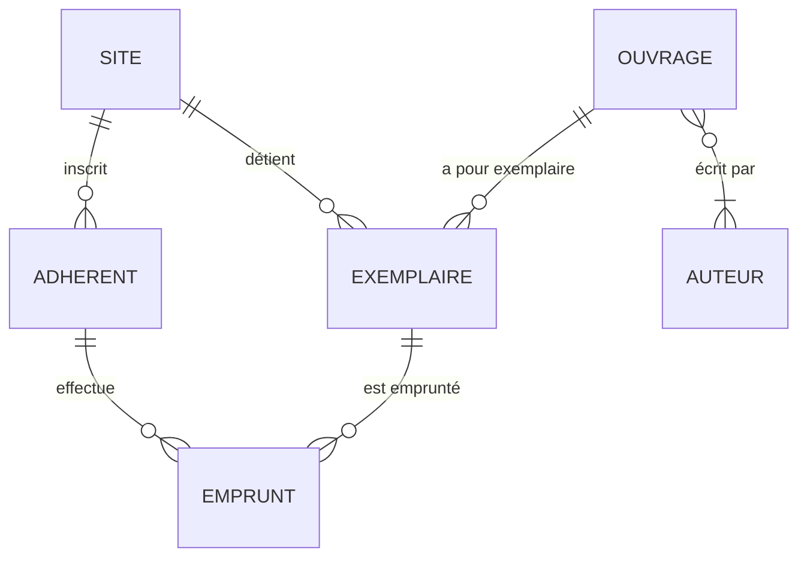

# Le modèle conceptuel des prêts de Valmorin

Le dictionnaire de données (les noms exacts, et ce que contiennent les données) est dans `infra/seed/CONTRAT.md`.

## Entités

Chaque entité a un identifiant, `id`.

| Entité | Propriétés |
|---|---|
| SITE | nom, ville |
| ADHÉRENT | numéro de carte, nom, prénom, email, téléphone, date d'inscription |
| AUTEUR | nom, prénom |
| OUVRAGE | ISBN, titre, année, éditeur |
| EXEMPLAIRE | code-barre, état |
| EMPRUNT | date d'emprunt, date de retour prévue, date de retour effective |

## Associations

Les cardinalités se lisent depuis l'entité, sous la forme minimum,maximum : « un ADHÉRENT est inscrit dans 1 et 1 seul SITE ; un SITE a 0 ou plusieurs ADHÉRENTS ».

```
ADHÉRENT    1,1 ──── inscrit dans ──── 0,n  SITE
EXEMPLAIRE  1,1 ──── détenu par ────── 0,n  SITE
EXEMPLAIRE  1,1 ──── exemplaire de ─── 0,n  OUVRAGE
OUVRAGE     1,n ──── écrit par ─────── 0,n  AUTEUR
EMPRUNT     1,1 ──── effectué par ──── 0,n  ADHÉRENT
EMPRUNT     1,1 ──── porte sur ─────── 0,n  EXEMPLAIRE
```


