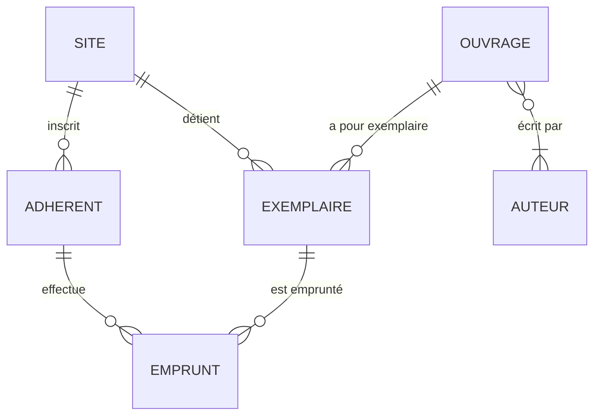

# Le modèle conceptuel des prêts de Valmorin

Le dictionnaire de données (ce que contiennent les données, et ce qui peut manquer) est dans `infra/seed/CONTRAT.md`.

## Les colonnes de chaque table

Les noms sont un contrat avec les données et les checks : orthographe exacte, en minuscules, sans accent. Les colonnes en `…_id` viennent des associations ci-dessous : une cardinalité 1,1 devient une clé étrangère du côté de l'entité qui porte le 1,1.

| Table | Colonnes |
|---|---|
| `site` | `id`, `nom`, `ville` |
| `adherent` | `id`, `numero_carte`, `nom`, `prenom`, `email`, `telephone`, `date_inscription`, `site_id` |
| `auteur` | `id`, `nom`, `prenom` |
| `ouvrage` | `id`, `isbn`, `titre`, `annee`, `editeur` |
| `ouvrage_auteur` | `ouvrage_id`, `auteur_id` |
| `exemplaire` | `id`, `ouvrage_id`, `site_id`, `code_barre`, `etat` |
| `emprunt` | `id`, `exemplaire_id`, `adherent_id`, `date_emprunt`, `date_retour_prevue`, `date_retour` |

## Entités

Chaque entité a un identifiant, `id`.

| Entité | Propriétés |
|---|---|
| SITE | nom, ville |
| ADHÉRENT | numéro de carte, nom, prénom, email, téléphone, date d'inscription |
| AUTEUR | nom, prénom |
| OUVRAGE | ISBN, titre, année, éditeur |
| EXEMPLAIRE | code-barre, état |
| EMPRUNT | date d'emprunt, date de retour prévue, date de retour effective |

## Associations

Les cardinalités se lisent depuis l'entité, sous la forme minimum,maximum : « un ADHÉRENT est inscrit dans 1 et 1 seul SITE ; un SITE a 0 ou plusieurs ADHÉRENTS ».

```
ADHÉRENT    1,1 ──── inscrit dans ──── 0,n  SITE
EXEMPLAIRE  1,1 ──── détenu par ────── 0,n  SITE
EXEMPLAIRE  1,1 ──── exemplaire de ─── 0,n  OUVRAGE
OUVRAGE     1,n ──── écrit par ─────── 0,n  AUTEUR
EMPRUNT     1,1 ──── effectué par ──── 0,n  ADHÉRENT
EMPRUNT     1,1 ──── porte sur ─────── 0,n  EXEMPLAIRE
```


